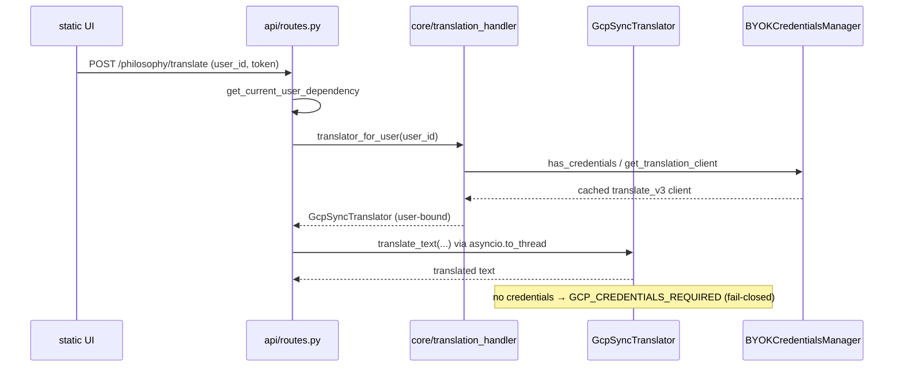

# Design: Lingo.dev Retirement — GCP Sync Engine for the Content Tier

Linked decision record: `docs/adr/0004-retire-lingo-dev-translation-stack.md` (D1–D7).

## 1. Scope

**In scope**
* New GCP synchronous translation engine (text + single-document).
* Credential-bound engine resolution for the content path (`/translate` job flow, `/philosophy/*` text translation).
* Full eradication of the Lingo.dev stack (REST client, MCP client, parallel-Lingo orphans) and all configuration/manifest/doc/test references.

**Out of scope (explicit)**
* Asynchronous `batchTranslateDocument` book pipeline (`services/gcp_batch_translation_service.py`) — unchanged.
* `services/enhanced_document_processor.py` (deprecated PyMuPDF-era processor) — pre-existing follow-up, tracked separately.
* Glossary-enforced sync translation (`TranslateTextGlossaryConfig` wiring) — Phase 2 follow-up; terminology substitution is preserved at the service layer in Phase 1.

## 2. Component Overview

| Component | Disposition | Purpose |
| :--- | :--- | :--- |
| `services/gcp_sync_translation_service.py` | **New** | `GcpSyncTranslator` (user-bound engine) + `GcpSyncTranslationService` (registry facade) |
| `core/translation_handler.py` | Modified | Singleton becomes a non-translating statistics/config facade; job flow gains user-bound engine resolution |
| `api/routes.py` | Modified | `/translate` + `/philosophy/translate` gain `user_id` + auth identity (mirrors `POST /book/translate`, `routes.py:1458-1465`) |
| `utils/document_errors.py` | Modified | New `GCP_CREDENTIALS_REQUIRED` code (503 semantics) |
| `services/byok_credentials_manager.py` | Reused (DRY) | `get_translation_client`, `get_project_id`, `get_credentials`, `has_credentials` |
| `services/translation_service.py` | **Deleted** | LingoTranslator/MCPLingoTranslator/TranslationService |
| `services/mcp_lingo_client.py` | **Deleted** | MCP stdio client (`npx -y lingo.dev mcp`) |
| `services/parallel_translation_service.py` | **Deleted** | Orphaned `ParallelLingoTranslator` stack |
| `services/enhanced_translation_service.py` | **Deleted** | Orphaned parallel wrapper |
| `services/__init__.py` | Modified | Remove `TranslationService` export; add symmetric exports + `_AVAILABLE` flag for the new engine (AGENTS §2.10) |
| `app.py` | Unchanged behavior | `translation_service.aclose()` at shutdown continues to work via facade no-op (documented) |

## 3. Engine Contract (Surface Parity — ADR 0004 D4)

```python
class GcpSyncTranslator:
    """User-bound synchronous Google Cloud Translation engine."""
    def __init__(self, credentials_manager: BYOKCredentialsManager, user_id: str) -> None: ...
    async def translate_text(self, text: str, source_lang: str, target_lang: str) -> str: ...
    async def translate_batch(self, texts: list[str], source_lang: str, target_lang: str) -> list[str]: ...
    async def translate_document(self, document: BinaryIO, mime_type: str,
                                 source_lang: str, target_lang: str) -> BinaryIO: ...
    def close(self) -> None: ...          # releases nothing (BYOK owns clients)
    async def aclose(self) -> None: ...   # async wrapper

class GcpSyncTranslationService:
    """Registry facade consumed by core.translation_handler (surface parity)."""
    @property
    def providers(self) -> dict[str, GcpSyncTranslator]: ...   # resolved per user
    def translator_for_user(self, user_id: str) -> GcpSyncTranslator: ...
    def get_available_providers(self) -> list[str]: ...        # ["gcp"]
    def get_statistics(self) -> dict[str, Any]: ...            # stable keys
    def update_configuration(self, **kwargs: Any) -> None: ... # philosophy-layer passthrough
    def close(self) -> None: ...
    async def aclose(self) -> None: ...
```

The philosophy service (`services/philosophy_enhanced_translation_service.py`)
keeps delegating to an injected engine without modification: it either receives
a user-bound `GcpSyncTranslator` (request path) or a lightweight unbound
stub at construction for statistics-only contexts.

## 4. Credential-Bound Resolution Flow

1. Endpoint resolves identity exactly as `POST /book/translate` does: explicit
   `user_id` parameter + `current_user = Depends(get_current_user_dependency)`.
2. Request path: `translator = translation_service.translator_for_user(user_id)`.
3. `GcpSyncTranslator.translate_*` verifies `credentials_manager.has_credentials(user_id)`;
   on miss, raises the typed credential error → route maps to `GCP_CREDENTIALS_REQUIRED`.
4. On hit, the engine borrows the cached `translate_v3.TranslationServiceClient`
   from `BYOKCredentialsManager.get_translation_client(user_id)` — **no bespoke
   client construction** (AGENTS §2.13 canonical-helper routing).
5. `/translate` background jobs embed the resolved `translator` in the job
   closure (`process_advanced_translation_job` signature gains the engine parameter),
   so a long-running job never re-resolves ambient identity.



## 5. GCP Request Shape (Sync Tier)

* `parent = projects/{project_id}/locations/us-central1` (region alignment with
  glossaries, AGENTS §2.1/§2.2).
* `contents` = strings (or single string); batched per `TRANSLATION_BATCH_SIZE`
  (existing `config/settings.py` value) to respect v3 request limits.
* `mime_type = "text/plain"`, `source_language_code`, `target_language_code`
  normalized through the existing language utilities.
* Document requests: `translateDocuments` with inline document bytes
  (`DocumentInputConfig`), reserved for sample/preview pages per §2.1.
* All remote calls go through `utils.gcp_helpers.retry_gcp_call` /
  `is_transient_gcp_error` (truncated exponential backoff + jitter) —
  no bespoke retry loops (AGENTS §2.13).

## 6. Concurrency & Non-Blocking I/O

* `google-cloud-translate` calls are synchronous: engines MUST wrap them in
  `asyncio.to_thread` inside the `async def translate_*` methods (AGENTS deny row:
  "Blocking Sync I/O in Async Paths").
* Per-job translation concurrency continues to be bounded by
  `TRANSLATION_CONCURRENCY_LIMIT` (`config/settings.py:424`); the retired
  Lingo rate-limiter logic is not re-implemented (GCP quota is user-scoped).

## 7. Error Model

| Condition | Behavior |
| :--- | :--- |
| `has_credentials(user_id) == False` | `GCP_CREDENTIALS_REQUIRED` (typed doc error → HTTP 503), fail-closed |
| Transient GCP error (429/503/500, gRPC 8/14) | Retried via `utils.gcp_helpers` backoff |
| Terminology substitution | Pre-request, word-boundary-safe (parity with `services/translation_service.py:603` behavior), ported to the new engine |
| Non-transient GCP error | Propagates as a structured document error; no silent success |

## 8. Test Strategy

* **Fake BYOK manager** (in-memory `credentials_manager` stub returning a
  `translate_v3` client facade whose methods are monkeypatched) — no real GCP
  access in CI (mirrors the existing "no external deps" test posture).
* Unit: surface parity (`get_available_providers`, statistics keys, `aclose`),
  fail-closed gate, terminology substitution, retry mapping, batch chunking.
* Integration: `/philosophy/translate` + `/translate` happy path and
  credential-missing path via `patch.dict(os.environ)` (AGENTS §6.6 caveats do
  not apply — memory routes are not touched).
* Eradication guards: import-sweep test asserting `lingo`/`mcp` never re-enter
  `services/`, `config/`, or `api/` (grep-based regression net mirroring the
  Dolphin pollution tests).
